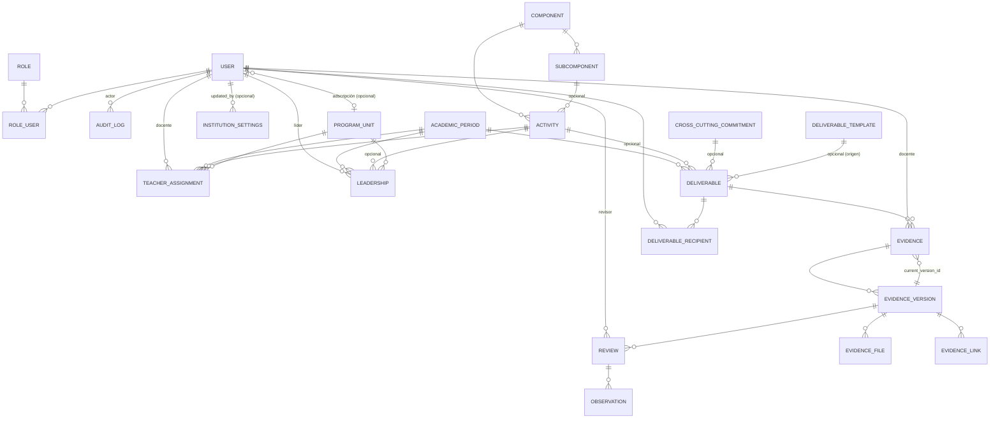

# Diccionario de datos — SIGAE-UTS

Este documento describe el esquema de base de datos implementado en
PostgreSQL. Por convención del proyecto, **todo el esquema está en
inglés** (tablas, columnas, modelos Eloquent, enums) — el español queda
reservado para textos de interfaz y contenido cargado por el usuario
(ver `docs/manual-tecnico.md`, sección 5.9, "Estructura de carpetas
relevantes").

Convenciones: claves primarias `id` (bigint autoincremental), claves
foráneas `<entidad_singular>_id`, fechas con sufijo `_at` (datetime) o
`_date`/sin sufijo cuando son solo fecha civil (`start_date`,
`due_at` es datetime porque un entregable puede vencer a una hora
específica). Todas las tablas de dominio tienen `created_at`/`updated_at`
salvo `audit_logs` (de solo escritura por diseño, solo `created_at`).

Fuente de este documento: las 31 migraciones en `database/migrations/`
(contenido real al 2026-10-20) y los modelos Eloquent correspondientes en
`app/Models/`. Donde una columna tiene un cast a enum, se referencia el
enum (`app/Enums/`) en vez de listar sus valores a mano, para que este
documento no se desincronice si el enum cambia.

## Diagrama entidad-relación



## Catálogo de tablas

### `users`

Cuentas de acceso de todo el personal (docentes, líderes, coordinación,
administradores, auditores) y su referencia institucional.

| Columna | Tipo | Nulo | Default | Notas |
|---|---|---|---|---|
| `id` | bigint | no | autoincremental | PK |
| `name` | string | no | — | Nombre completo |
| `document_number` | string | sí | `null` | Único; cédula u otro identificador institucional |
| `document_type` | string | sí | `null` | **Agregada 2026-10-05.** Código crudo (`CC`, `CE`, `TI`, `PA` — los mismos 4 que acepta la importación masiva, ver `App\Services\TeacherImport\TeacherImportService::DOCUMENT_TYPES`). Deliberadamente **sin** cast a `App\Enums\DocumentType` (ese enum es solo la etiqueta legible, reutilizada en `UserForm`/"Mi perfil"/`AuditLogPresenter`): un cast a enum rompería la comparación cruda que hace `TeacherImportService::resolveAction()` contra el valor del archivo importado |
| `program_unit_id` | bigint | sí | `null` | **Agregada 2026-10-05.** FK a `program_units`, `nullOnDelete`. Programa de adscripción informativo del docente/líder — independiente de `teacher_assignments`/`leaderships` reales; cambiarlo solo afecta los filtros de Coordinación e Informes |
| `email` | string | no | — | Único; usado para login |
| `email_verified_at` | timestamp | sí | `null` | No usado activamente (no hay verificación de correo en el MVP) |
| `password` | string | no | — | Hash bcrypt (cast `hashed` de Laravel) |
| `is_active` | boolean | no | `true` | Cuenta desactivada no puede iniciar sesión, pero conserva todo su histórico |
| `remember_token` | string | sí | `null` | Para "recordarme" |
| `created_at`, `updated_at` | timestamp | — | — | |

**Relaciones**: `roles` (N:N vía `role_user`), `programUnit` (N:1), `teacherAssignments`/`leaderships`/`evidences` (1:N, como docente/líder según el rol), `institutionSettings.updatedBy` (1:N inverso, opcional).

### `roles`

Catálogo fijo de roles del sistema (sembrado por `RoleSeeder`, no
editable desde la interfaz).

| Columna | Tipo | Nulo | Default | Notas |
|---|---|---|---|---|
| `id` | bigint | no | autoincremental | PK |
| `name` | string | no | — | Único; slug en inglés: `administrator`, `coordination`, `leader`, `teacher`, `auditor` (`App\Enums\RoleName`) |
| `label` | string | no | — | Etiqueta en español para mostrar en la interfaz (ej. "Administrador") |
| `created_at`, `updated_at` | timestamp | — | — | |

### `role_user` (pivote)

Relación N:N entre `users` y `roles` — un usuario puede tener varios
roles simultáneamente (ej. un líder que también es docente).

| Columna | Tipo | Nulo | Notas |
|---|---|---|---|
| `id` | bigint | no | PK |
| `user_id` | bigint | no | FK `users`, `cascadeOnDelete` |
| `role_id` | bigint | no | FK `roles`, `cascadeOnDelete` |
| `created_at`, `updated_at` | timestamp | — | |

Única `(user_id, role_id)`.

### `program_units`

Programa académico o unidad donde aplica una asignación (catálogo
parametrizable).

| Columna | Tipo | Nulo | Default | Notas |
|---|---|---|---|---|
| `id` | bigint | no | autoincremental | PK |
| `name` | string | no | — | Único |
| `is_active` | boolean | no | `true` | Se desactiva, nunca se borra |
| `created_at`, `updated_at` | timestamp | — | — | |

### `components`

Docencia, Investigación, Extensión, Otras actividades, u otros que se
configuren (catálogo parametrizable).

| Columna | Tipo | Nulo | Default | Notas |
|---|---|---|---|---|
| `id` | bigint | no | autoincremental | PK |
| `name` | string | no | — | Único |
| `is_active` | boolean | no | `true` | Se desactiva, nunca se borra |
| `created_at`, `updated_at` | timestamp | — | — | |

### `subcomponents`

Subcategoría dentro de un componente (ej. Procesos OACA, Procesos ODA,
Comités, Otras).

| Columna | Tipo | Nulo | Default | Notas |
|---|---|---|---|---|
| `id` | bigint | no | autoincremental | PK |
| `component_id` | bigint | no | — | FK a `components`, `restrictOnDelete` |
| `name` | string | no | — | Único junto con `component_id` |
| `is_active` | boolean | no | `true` | Se desactiva, nunca se borra |
| `created_at`, `updated_at` | timestamp | — | — | |

### `activities`

Actividad concreta del catálogo, siempre ligada a un componente y
opcionalmente a un subcomponente.

| Columna | Tipo | Nulo | Default | Notas |
|---|---|---|---|---|
| `id` | bigint | no | autoincremental | PK |
| `component_id` | bigint | no | — | FK a `components`, `restrictOnDelete` |
| `subcomponent_id` | bigint | sí | `null` | FK a `subcomponents`, `nullOnDelete` |
| `name` | string | no | — | Ver restricción de unicidad abajo |
| `is_active` | boolean | no | `true` | Se desactiva, nunca se borra |
| `created_at`, `updated_at` | timestamp | — | — | |

**Restricciones de unicidad** (agregadas 2026-09-25, respaldo a nivel de
BD contra duplicados exactos; la protección real insensible a
mayúsculas/tildes la hace `App\Rules\CaseAccentInsensitiveUnique` en el
formulario):
- `UNIQUE(component_id, subcomponent_id, name)` para cuando sí hay subcomponente.
- Índice único parcial `activities_component_name_unique_no_subcomponent` sobre `(component_id, name) WHERE subcomponent_id IS NULL` — necesario porque Postgres trata cada `NULL` como distinto en un índice único normal.

### `academic_periods`

Periodo académico y su estado.

| Columna | Tipo | Nulo | Default | Notas |
|---|---|---|---|---|
| `id` | bigint | no | autoincremental | PK |
| `name` | string | no | — | Único. Ej. "2026-1" |
| `status` | string | no | `'planning'` | Enum `App\Enums\AcademicPeriodStatus`: `planning`, `active`, `closed`, `archived` |
| `start_date`, `end_date` | date | no | — | Solo editables mientras `status = planning` |
| `created_at`, `updated_at` | timestamp | — | — | |

Transiciones válidas: `planning → active → closed → archived`, y
excepcionalmente `closed → active` (reapertura, auditada — ver
`audit_logs`).

### `teacher_assignments`

Asignación de una actividad a un docente dentro de un periodo, con sus
horas. **Las horas son puramente informativas** (columna `assigned_hours`):
ninguna regla del sistema las usa para calcular avance ni cantidad de
entregables.

| Columna | Tipo | Nulo | Default | Notas |
|---|---|---|---|---|
| `id` | bigint | no | autoincremental | PK |
| `user_id` | bigint | no | — | FK `users` (docente), `cascadeOnDelete` |
| `academic_period_id` | bigint | no | — | FK, `restrictOnDelete` |
| `activity_id` | bigint | no | — | FK, `restrictOnDelete` |
| `program_unit_id` | bigint | no | — | FK, `restrictOnDelete` |
| `assigned_hours` | decimal(5,2) | no | — | Informativo únicamente |
| `notes` | text | sí | `null` | |
| `created_at`, `updated_at` | timestamp | — | — | |

Única `(user_id, academic_period_id, activity_id, program_unit_id)` —
evita duplicados exactos, pero permite que un docente tenga varias
actividades y que una actividad tenga varios docentes.

**Índice de rendimiento** (agregado 2026-09-25): `(academic_period_id,
program_unit_id, activity_id)` — usado por `Dashboard::leaderPanel()`,
que filtra por estas 3 columnas sin tocar `user_id`.

### `leaderships`

Uno o varios líderes por ámbito (programa completo o una actividad
puntual) y periodo, con vigencia temporal.

| Columna | Tipo | Nulo | Default | Notas |
|---|---|---|---|---|
| `id` | bigint | no | autoincremental | PK |
| `user_id` | bigint | no | — | FK `users` (líder), `cascadeOnDelete` |
| `activity_id` | bigint | sí | `null` | FK, `nullOnDelete`. Si es nulo, el ámbito es todo el `program_unit_id` |
| `program_unit_id` | bigint | no | — | FK, `restrictOnDelete` |
| `academic_period_id` | bigint | no | — | FK, `restrictOnDelete` |
| `starts_at`, `ends_at` | date | `ends_at` sí | `ends_at` → `null` | `ends_at` nulo = vigente. Se "finaliza" fijando `ends_at`, nunca se borra |
| `created_at`, `updated_at` | timestamp | — | — | |

`User::canLeadAssignment()` resuelve si un líder puede ver/revisar una
`teacher_assignment` concreta a partir de estas columnas + la fecha
actual.

**Índice de rendimiento** (agregado 2026-09-25): `(user_id,
academic_period_id, program_unit_id)` — usado por
`User::leaderships()->where('academic_period_id', ...)` y por el `JOIN`
de `Evidence::scopeReviewableBy()`.

### `cross_cutting_commitments`

Clasificación para entregables que no dependen de una actividad de la
distribución (catálogo parametrizable).

| Columna | Tipo | Nulo | Default | Notas |
|---|---|---|---|---|
| `id` | bigint | no | autoincremental | PK |
| `name` | string | no | — | Único |
| `is_active` | boolean | no | `true` | Se desactiva, nunca se borra |
| `created_at`, `updated_at` | timestamp | — | — | |

### `deliverable_templates`

Configuración reutilizable de un entregable (no tiene fechas propias;
sirve para prellenar entregables concretos).

| Columna | Tipo | Nulo | Default | Notas |
|---|---|---|---|---|
| `id` | bigint | no | autoincremental | PK |
| `name` | string | no | — | **Único desde 2026-10-05** (respaldo a nivel de BD; la protección real insensible a mayúsculas/tildes la hace `CaseAccentInsensitiveUnique` en `TemplateForm::save()`) |
| `description`, `instructions`, `completion_criteria` | text | sí | `null` | |
| `is_mandatory` | boolean | no | `true` | |
| `periodicity_type` | string | no | — | Enum `App\Enums\PeriodicityType`: `single`, `by_term`, `monthly`, `biweekly`, `weekly`, `by_milestone`, `extraordinary` |
| `allowed_evidence_types` | json | no | — | Array de `App\Enums\EvidenceType`: `file`, `text`, `link` (ver nota de migración de fusión más abajo) |
| `allowed_file_types` | json | sí | `null` | Array de extensiones, ej. `["pdf","docx"]` |
| `max_files` | unsigned int | no | `1` | |
| `max_file_size_mb` | unsigned int | no | `10` | |
| `weight_percentage` | unsigned tinyint | sí | `null` | 1–100 |
| `is_active` | boolean | no | `true` | |
| `created_at`, `updated_at` | timestamp | — | — | |

### `deliverables`

La obligación concreta: fechas, reglas y ámbito. Copia (no referencia
en vivo) los valores de la plantilla al crearse, para que un cambio
posterior en la plantilla no altere retroactivamente entregables ya
creados.

| Columna | Tipo | Nulo | Default | Notas |
|---|---|---|---|---|
| `id` | bigint | no | autoincremental | PK |
| `deliverable_template_id` | bigint | sí | `null` | FK, `nullOnDelete`. Solo trazabilidad de origen |
| `status` | string | no | `'published'` | **Agregada 2026-10-05.** Enum `App\Enums\DeliverableStatus`: `draft`, `published`. Default `'published'` para que todo entregable ya existente antes de esta columna quedara igual que antes (visible, con destinatarios/evidencia ya sincronizados). Un Borrador nunca es visible para los docentes ni genera evidencia |
| `academic_period_id` | bigint | no | — | FK, `restrictOnDelete` |
| `activity_id` | bigint | sí | `null` | FK, `restrictOnDelete`. Mutuamente excluyente con `cross_cutting_commitment_id` |
| `cross_cutting_commitment_id` | bigint | sí | `null` | FK, `restrictOnDelete`. Mutuamente excluyente con `activity_id` |
| `name` | string | no | — | |
| `description`, `instructions`, `completion_criteria` | text | sí | `null` | |
| `is_mandatory` | boolean | no | `true` | Solo los obligatorios afectan el % de avance |
| `periodicity_type` | string | no | — | Ver enum arriba |
| `opens_at`, `due_at` | datetime | no | — | |
| `closes_at` | datetime | sí | `null` | |
| `allowed_evidence_types` | json | no | — | Ver enum `EvidenceType` arriba |
| `allowed_file_types` | json | sí | `null` | |
| `max_files` | unsigned int | no | `1` | |
| `max_file_size_mb` | unsigned int | no | `10` | |
| `weight_percentage` | unsigned tinyint | sí | `null` | |
| `created_at`, `updated_at` | timestamp | — | — | |

**Restricción a nivel de base de datos** (`CHECK`, no solo validación de
aplicación):

```sql
ALTER TABLE deliverables ADD CONSTRAINT deliverables_exactly_one_scope
CHECK ((activity_id IS NOT NULL)::int + (cross_cutting_commitment_id IS NOT NULL)::int = 1)
```

**Índice de rendimiento** (agregado 2026-09-25): `academic_period_id` —
filtro repetido en casi toda la app (Dashboard, `DeliverableForm`,
`AssignmentForm`, `LeadershipForm`...).

**Migración de fusión de tipos de evidencia (2026-10-05, irreversible):**
el valor `multiple_files` de `allowed_evidence_types` se fusionó con
`file` (ver `App\Enums\EvidenceType`, que ya no tiene un caso
`MultipleFiles` — `max_files` siempre fue el único campo real que
controla la cantidad). Cualquier fila sembrada antes de esa fecha con
`"multiple_files"` en su JSON fue reescrita a `"file"`; no es posible
distinguir retroactivamente cuáles filas tenían originalmente cuál valor.

### `deliverable_recipients` (pivote)

Docente(s) destinatario(s) de un entregable concreto.

| Columna | Tipo | Nulo | Notas |
|---|---|---|---|
| `id` | bigint | no | PK |
| `deliverable_id` | bigint | no | FK, `cascadeOnDelete` |
| `user_id` | bigint | no | FK, `cascadeOnDelete` |
| `created_at`, `updated_at` | timestamp | — | |

Única `(deliverable_id, user_id)`.

Al guardar destinatarios se crea automáticamente una `evidence` en
estado `pending` para cada uno (`Deliverable::ensureEvidencesForRecipients()`);
si alguien deja de ser destinatario, su evidencia ya creada **no se
borra**.

### `evidences`

Registro presentado por el docente para un entregable — el "expediente"
que agrupa todas sus versiones.

| Columna | Tipo | Nulo | Default | Notas |
|---|---|---|---|---|
| `id` | bigint | no | autoincremental | PK |
| `deliverable_id` | bigint | no | — | FK, `cascadeOnDelete` |
| `user_id` | bigint | no | — | FK (docente), `cascadeOnDelete` |
| `status` | string | no | `'pending'` | Enum `App\Enums\EvidenceStatus`: `pending`, `draft`, `submitted`, `needs_adjustment`, `approved`, `expired`, `exempt` |
| `exemption_reason` | text | sí | `null` | **Agregada 2026-10-04.** Motivo que el propio docente (o Administrador/Coordinación) debe explicar al marcar la evidencia como `exempt` (ver `Evidence::markExempt()`/`removeExemption()`). Antes de esta columna, ese motivo solo vivía en `audit_logs.metadata->justification` (un registro de solo lectura, nunca mostrado a nadie); esta migración hizo un *backfill* desde ahí para las evidencias que ya estaban exentas al momento de aplicarla |
| `current_version_id` | bigint | sí | `null` | FK a `evidence_versions`, `nullOnDelete`. Agregada en una migración posterior por dependencia circular con `evidence_versions` |
| `created_at`, `updated_at` | timestamp | — | — | |

Única `(deliverable_id, user_id)` — un docente tiene como máximo un
expediente de evidencia por entregable (el histórico vive en
`evidence_versions`, no en filas duplicadas de `evidences`).

**Índices de rendimiento** (agregados 2026-09-25): `status` y `user_id`
por separado (el `UNIQUE(deliverable_id, user_id)` existente solo cubre
`user_id` como segunda columna, no como filtro independiente) —
usados por `ReviewInbox`, `Dashboard` (`leaderPanel`/`coordinationPanel`),
`UserForm` y `User::evidences()`.

### `evidence_versions`

Cada ajuste o reenvío genera una versión nueva; ninguna versión anterior
se modifica ni se borra.

| Columna | Tipo | Nulo | Notas |
|---|---|---|---|
| `id` | bigint | no | PK |
| `evidence_id` | bigint | no | FK, `cascadeOnDelete` |
| `version_number` | unsigned int | no | Único junto con `evidence_id` |
| `description` | text | sí | Notas del docente; también es el contenido cuando el tipo de evidencia incluye "texto" |
| `submitted_at` | datetime | sí | Nulo mientras es borrador; al fijarse, la versión queda protegida contra edición |
| `created_by` | bigint | no | FK `users`, `restrictOnDelete` |
| `created_at`, `updated_at` | timestamp | — | |

### `evidence_files`

Archivo adjunto a una versión de evidencia.

| Columna | Tipo | Nulo | Notas |
|---|---|---|---|
| `id` | bigint | no | PK |
| `evidence_version_id` | bigint | no | FK, `cascadeOnDelete` |
| `original_name` | string | no | Nombre visible para el usuario |
| `stored_name` | string | no | Único. Nombre real en disco — generado aleatoriamente por Laravel (`Illuminate\Http\UploadedFile::store()`), nunca predecible ni igual al nombre original |
| `disk_path` | string | no | Ruta relativa dentro del disco `local` (privado, `storage/app/private`, sin URL pública — ver `config/filesystems.php`) |
| `mime_type` | string | no | Detectado del archivo real, no solo por extensión |
| `size_bytes` | unsigned bigint | no | |
| `created_at`, `updated_at` | timestamp | — | |

### `evidence_links`

Enlace registrado como soporte.

| Columna | Tipo | Nulo | Notas |
|---|---|---|---|
| `id` | bigint | no | PK |
| `evidence_version_id` | bigint | no | FK, `cascadeOnDelete` |
| `url` | string | no | |
| `label` | string | sí | |
| `created_at`, `updated_at` | timestamp | — | |

### `reviews`

Decisión de un líder/coordinación/administrador sobre una versión de
evidencia concreta.

| Columna | Tipo | Nulo | Notas |
|---|---|---|---|
| `id` | bigint | no | PK |
| `evidence_version_id` | bigint | no | FK, `cascadeOnDelete` |
| `reviewer_id` | bigint | no | FK `users`, `restrictOnDelete` |
| `decision` | string | no | Enum `App\Enums\ReviewDecision`: `approved`, `returned` |
| `decided_at` | datetime | no | |
| `created_at`, `updated_at` | timestamp | — | |

### `observations`

Comentario asociado a una revisión (obligatorio si la decisión es
`returned`).

| Columna | Tipo | Nulo | Notas |
|---|---|---|---|
| `id` | bigint | no | PK |
| `review_id` | bigint | no | FK, `cascadeOnDelete` |
| `body` | text | no | |
| `created_at`, `updated_at` | timestamp | — | |

### `institution_settings`

**Tabla nueva (2026-10-05).** Fila única (singleton) con el nombre y los
logos institucionales configurables desde Administración, en vez de
hardcodeados — ver `App\Models\InstitutionSettings`. Se decidió
deliberadamente **no** generalizarla a una tabla `system_parameters`
tipo llave-valor (ver "Desviaciones" abajo): sigue sin existir un segundo
parámetro global que justifique esa generalización.

| Columna | Tipo | Nulo | Default | Notas |
|---|---|---|---|---|
| `id` | bigint | no | `1` (forzado) | PK. `CHECK(id = 1)` a nivel de base de datos — singleton garantizado, no solo por convención de aplicación |
| `name` | string | no | — | Sembrado inicialmente con "Institución Universitaria Tecnológica de Santander" |
| `logo_login_path` | string | sí | `null` | Ruta dentro del disco `institution` (público). `null` = usar el logo estático de `public/images/logo/` — nunca una ruta vacía que haya que interpretar. Logo apaisado, solo para `guest.blade.php` (pantalla de login) |
| `logo_mark_path` | string | sí | `null` | Mismo criterio que arriba. Logo cuadrado, usado en el sidebar, el PDF de informes (`ReportTheme::logoPath()`) y las plantillas de correo |
| `updated_by` | bigint | sí | `null` | FK `users`, `nullOnDelete` |
| `created_at`, `updated_at` | timestamp | — | — | |

### `audit_logs`

Bitácora de acciones críticas. **Sin `updated_at`** — es un registro de
solo escritura desde el punto de vista de la aplicación (no existe
ninguna ruta que permita editarlo o borrarlo).

| Columna | Tipo | Nulo | Default | Notas |
|---|---|---|---|---|
| `id` | bigint | no | autoincremental | PK |
| `user_id` | bigint | sí | `null` | FK `users`, `nullOnDelete`. Actor; nulo en intentos de login fallidos y en acciones del scheduler (ej. `evidences:mark-overdue`) |
| `action` | string | no | — | Ej. `login`, `login_failed`, `login_blocked_inactive`, `logout`, `created`, `updated`, `evidence_marked_exempt`, `evidence_exemption_removed`, `evidence_marked_overdue` |
| `auditable_type`, `auditable_id` | morph | sí | `null` | Referencia polimórfica al registro afectado |
| `metadata` | json | sí | `null` | Valor nuevo (`changes`), valor anterior (`previous`) y campos redactados (`redacted_fields`) — nunca contiene contraseñas |
| `ip_address` | string(45) | sí | `null` | Ver `docs/manual-tecnico.md` §5.16 — base legal y a quién se le permite consultarla |
| `created_at` | datetime | no | — | Único timestamp de la tabla |

**Índices de rendimiento** (agregados 2026-09-21): `created_at`,
`user_id` y `action` por separado — `AuditLogIndex` siempre ordena por
`created_at` DESC y opcionalmente filtra por los otros dos, y
`foreignId()->constrained()` **no** crea un índice en PostgreSQL por sí
solo (a diferencia de MySQL/InnoDB).

**`action`, `auditable_type` y las claves de `metadata->changes`/`metadata->previous` se
guardan siempre en inglés/snake_case, a propósito** — es nomenclatura de
código (y de qué se filtra en el `WHERE`), no texto para mostrar. La
traducción a español para la pantalla de Auditoría
(`admin/audit-logs`) vive en un único lugar,
`App\Services\Audit\AuditLogPresenter`, que la tabla y el filtro
"Acción" reutilizan por igual — nunca se traduce el valor almacenado.
Ver `docs/manual-tecnico.md` §5.12 para el detalle completo (qué pasa
con un valor sin traducción mapeada, por qué "Cuenta desactivada" solo
aplica a `User` y no a los demás catálogos, campos redactados, etc.).

## Tablas de infraestructura de Laravel (no son parte del modelo de dominio)

`cache`, `jobs`, `job_batches`, `failed_jobs`, `password_reset_tokens`,
`sessions` — generadas por el framework para cachés, colas, la sesión
con `SESSION_DRIVER=database`, etc. No requieren diccionario propio.

No existe una tabla `notifications`: las 14 clases de notificación del
sistema (`app/Notifications/`) usan únicamente el canal `mail` de
Laravel (`via(): ['mail']`), nunca el canal `database` — por eso no hay
ninguna fila de notificación persistida, solo el *job* en cola
(`jobs`, mientras se procesa) y el correo ya enviado.

## Desviaciones respecto al modelo conceptual original

Dos de las tres tablas mencionadas en la especificación inicial que no
se implementaron siguen sin existir, pero la **funcionalidad** que una de
ellas representaba sí se construyó después por otro camino — se
corrige esa nota frente a la versión anterior de este documento:

- **`system_parameters`**: sigue sin existir. No se necesitó ninguna
  configuración global tipo llave-valor — todo lo "parametrizable" del
  sistema (componentes, subcomponentes, actividades, programas,
  compromisos transversales, plantillas de entregables, y desde
  2026-10-05 también la identidad institucional vía `institution_settings`)
  terminó siendo un catálogo propio con su propia tabla y pantalla de
  administración, más explícito y seguro (con sus propias validaciones)
  que un almacén genérico.
- **`imports`**: sigue sin existir una tabla propia para auditar
  importaciones. **Corrección:** la funcionalidad sí se construyó
  (2026-10-05, `App\Services\TeacherImport\TeacherImportService`,
  Administración → Usuarios → Importar docentes) — una plantilla Excel,
  validación fila por fila con vista previa, y un resumen de
  creados/actualizados/omitidos/rechazados. Pero es para **cuentas de
  usuario** (docentes/líderes), no para la "distribución docente" que la
  especificación original tenía en mente; y no deja una fila de
  auditoría dedicada por archivo importado, solo la entrada genérica
  `created`/`updated` de `audit_logs` por cada fila procesada (vía el
  trait `Auditable` de `User`).
- **`notifications`**: sigue sin existir esa tabla (ver nota en la
  sección anterior). **Corrección:** la nota anterior de este documento
  decía que "no se implementó un sistema de notificaciones push/email" —
  eso ya no es cierto. Desde 2026-09-23 el sistema envía 14 notificaciones
  reales por correo (asignación de entregable, envío, aprobación,
  devolución, vencimiento, exención y su reverso, asignación de
  liderazgo, restablecimiento de contraseña), todas vía el canal `mail`
  encolado (`ShouldQueue`, `QUEUE_CONNECTION=database`) — simplemente no
  usan el canal `database` de notificaciones de Laravel, así que no
  generan una fila en una tabla `notifications` (que de todos modos
  nunca existió).

## Qué se agregó o corrigió frente a la versión anterior de este documento

- **Tabla nueva**: `institution_settings`.
- **Columnas nuevas**: `users.document_type`, `users.program_unit_id`,
  `deliverables.status`, `evidences.exemption_reason`.
- **Restricciones nuevas documentadas**: unicidad de `activities.name`
  (compuesta + índice parcial), unicidad de `deliverable_templates.name`,
  `CHECK(id = 1)` de `institution_settings`.
- **Índices de rendimiento documentados** (ninguno estaba en la versión
  anterior): `audit_logs` (`created_at`, `user_id`, `action`),
  `evidences` (`status`, `user_id`), `deliverables.academic_period_id`,
  `teacher_assignments` y `leaderships` (compuestos).
- **Enum `EvidenceType` corregido**: ya no incluye `multiple_files`
  (fusionado con `file` en 2026-10-05); se documenta la migración de
  fusión y su irreversibilidad.
- **Sección "Desviaciones" corregida**: las notas sobre `imports` y
  `notifications` afirmaban que esas funcionalidades no existían — ya
  no es cierto para ninguna de las dos (ver arriba); se mantiene la nota
  solo sobre la ausencia de las *tablas* `imports`/`notifications` en sí.
- **Nuevo**: nota explícita de que no existe tabla `notifications`
  porque el sistema solo usa el canal `mail`.
- **Diagrama entidad-relación**: se agregó `INSTITUTION_SETTINGS` y su
  relación opcional con `USER` (`updated_by`), y la relación opcional
  `USER`→`PROGRAM_UNIT` (adscripción).
- **Formato**: se agregaron columnas explícitas de Nulo/Default en las
  tablas que antes solo tenían "Notas", para que esa información no
  dependiera de inferirla del código.
